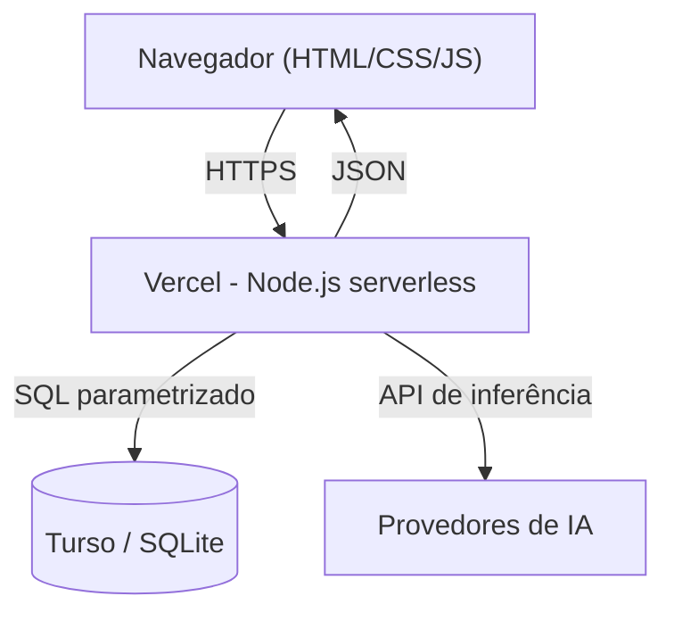

# ABADON AI — Global Solution Cloud FIAP 2026

**Aluno:** Diogo Carvalho Conceição · **RM:** 567792  
**Professor:** Eduardo Popovici · **Disciplina:** Cloud Computing

## Aplicação

- **Deploy existente:** https://abadonsayhello-ai.vercel.app
- **Frontend:** HTML, CSS e JavaScript.
- **Backend:** Node.js 22, funções serverless da Vercel.
- **Banco SQL:** Turso/libSQL (compatível com SQLite), acessado via `@libsql/client`.
- **API REST:** CRUD de incidentes, verificações de saúde, estatísticas e geração de relatórios DOCX.

## Rotas verificadas no código

| Método | Endpoint | Finalidade |
|---|---|---|
| GET | `/api/health` | Verifica conexão com banco de dados |
| GET | `/api/status` | Exibe configuração resumida dos agentes |
| GET | `/api/incidents` | Lista incidentes com paginação |
| POST | `/api/incidents` | Cadastra incidente |
| GET | `/api/incidents/{id}` | Consulta incidente |
| PUT/PATCH | `/api/incidents/{id}` | Atualiza incidente |
| DELETE | `/api/incidents/{id}` | Exclui incidente |
| GET | `/api/stats` | Estatísticas agregadas |
| POST | `/api/report` | Geração de documento DOCX |

## Arquitetura

O projeto **não utiliza VM própria**; por isso, SKU de máquina virtual não se aplica. A execução ocorre em funções gerenciadas (serverless).

## Variáveis de ambiente

- `TURSO_DATABASE_URL`
- `TURSO_AUTH_TOKEN`\n- `GS_API_KEY` (cabeçalho `x-api-key` para operações de escrita)
- `GROQ_API_KEY`, `GEMINI_API_KEY` (quando os respectivos agentes estiverem configurados)
- `FREE_TIER_CONFIRMED` (sinalizador de configuração)

**Nunca adicione chaves reais ao GitHub.** Armazene-as exclusivamente nas configurações seguras da Vercel.

## Estado da recuperação e validação (09/11/2026)

O **frontend público completo** foi sincronizado diretamente da versão publicada na Vercel, incluindo páginas HTML, CSS, JavaScript, biblioteca de estudos e OpenAPI. As rotas principais de API recuperadas também estão presentes. Porém, os módulos privados `lib/db.js`, `lib/core.js` e `lib/common.js`, além de algumas rotas de IA, **ainda não foram integralmente recuperados**; por isso, este repositório ainda não é autossuficiente para novo deploy. A produção não foi alterada.

O deployment estava `READY`. Testes HTTP reais em 09/11/2026 confirmaram `GET /api/health` (200, Turso conectado), `GET /api/incidents` (200), `GET /api/stats` (200), e `GET /api/incidents/999999` (404). Requisições POST/PATCH/DELETE **sem** `x-api-key` retornaram 401, confirmando proteção de escrita, não CRUD autenticado. Veja `docs/evidencias/testes-http-2026-11-09.md`. Agentes de IA, escrita autenticada e capturas visuais ainda precisam de comprovação.

## Entrega acadêmica

- Relatório técnico: arquitetura, componentes de nuvem, API e banco SQL.
- Repositório GitHub com código recuperado (sincronização integral ainda pendente).
- Evidências pendentes: print da aplicação, requisições da API, painel Turso e deployment Vercel.
- A entrega completa exige sincronizar os arquivos faltantes, validar as rotas em produção e anexar capturas reais.

Consulte também `docs/roteiro-de-testes.md` e `docs/schema-referencia.sql`.
